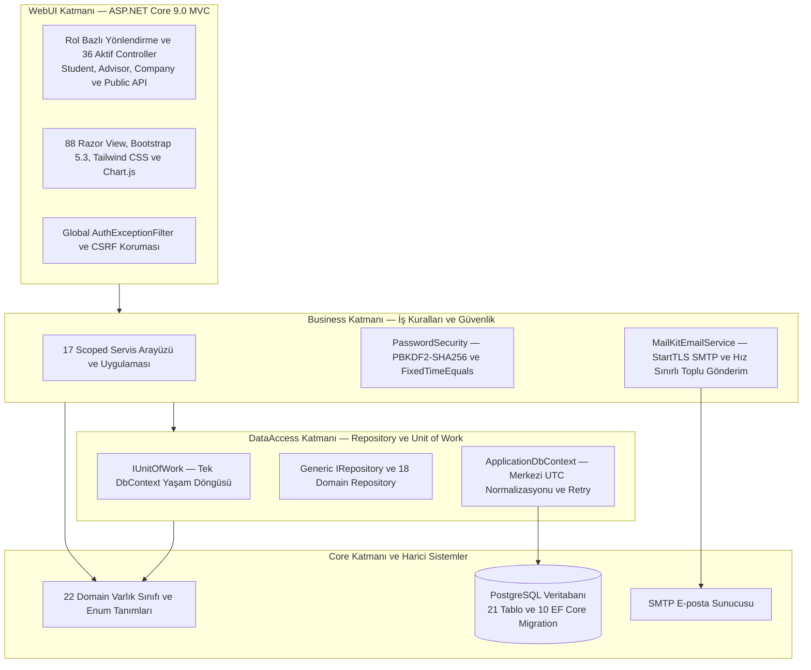
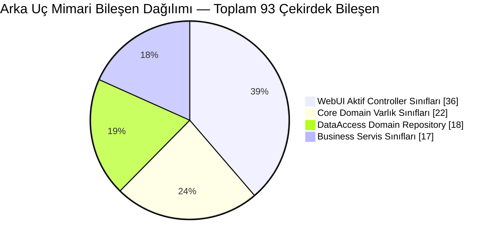
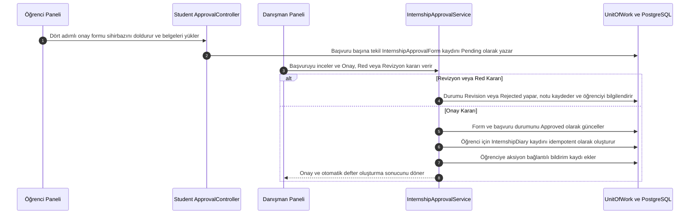
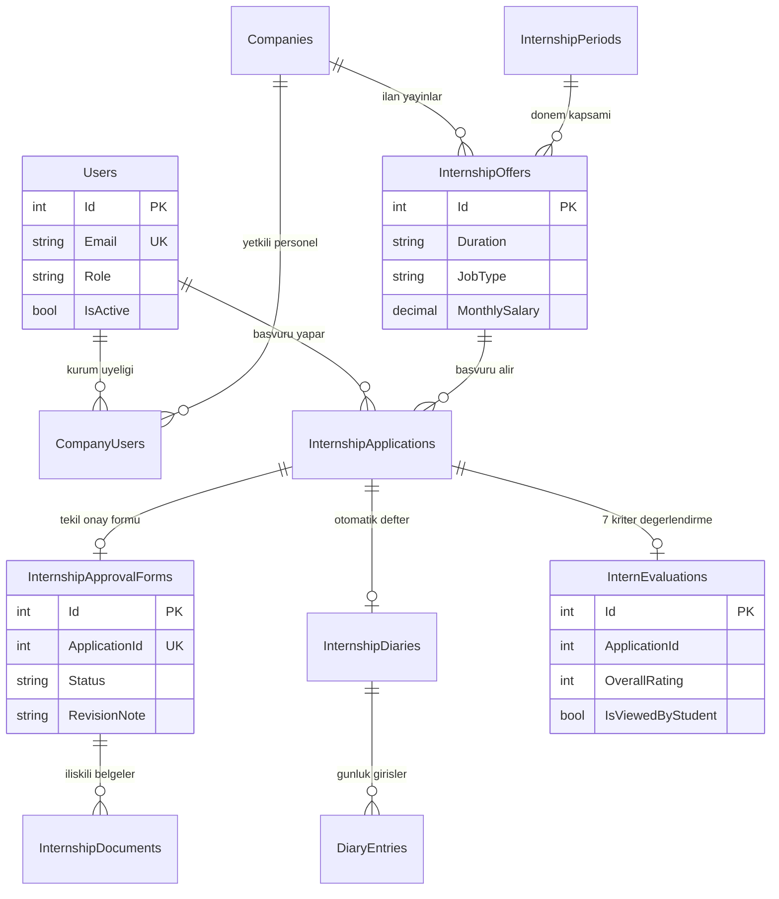
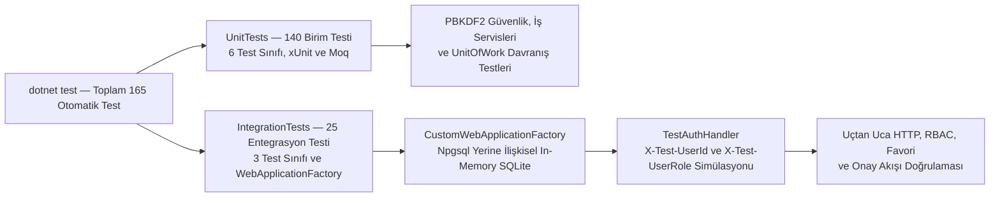

# InternshipTrackingSystem — Kurumsal Staj ve Onay Yönetim Platformu

InternshipTrackingSystem, üniversite öğrencileri, akademik danışmanlar ve şirketler arasındaki staj süreçlerini tek bir çatı altında toplayan ASP.NET Core 9.0 MVC tabanlı bir web uygulamasıdır. Kurumlarda çoğu zaman dağınık e-posta yazışmaları, elden dolaşan formlar ve takibi zor tablolarla yürütülen staj operasyonları hem idari yükü artırır hem de onay aşamalarında ciddi gecikmelere yol açar. Bu sistem; staj ilanı yayınlama, öğrenci başvurusu, çok adımlı danışman onay ve revizyon süreci, belge yönetimi, staj defteri takibi, şirket içi stajyer değerlendirme ve rol bazlı bildirim ile mesajlaşma akışlarını veritabanı destekli ve durum takipli bir iş akışına dönüştürür.

Proje, sürdürülebilirlik ve test edilebilirlik odağıyla dört katmanlı modüler bir mimari üzerinde inşa edilmiştir. Veri kalıcılığı PostgreSQL üzerinde Entity Framework Core 9.0 ile yönetilirken, kimlik güvenliği zamanlama saldırılarına dayanıklı PBKDF2 parola doğrulaması ve rol bazlı çerez oturumlarıyla güvence altına alınmıştır. Sistemin iş kuralları, güvenlik mekanizmaları ve veri erişim tutarlılığı toplam 165 adet otomatik birim ve entegrasyon testiyle doğrulanmaktadır.

## Sistem Mimarisi ve Katman Tasarımı

Çözüm dosyası dört ana uygulama katmanı ile iki ayrı test projesinden oluşan klasik N-Tier mimari kurgusuna sahiptir. Bağımlılıklar `WebUI` katmanından `Business`, `DataAccess` ve `Core` katmanlarına doğru tek yönlü akar. Bu ayrım sayesinde veritabanı erişim mantığı ile iş kuralları sunum katmanından tamamen izole edilir ve her katman bağımsız olarak test edilebilir.



Sunum katmanındaki 36 aktif controller, öğrenci, akademik danışman, şirket ve herkese açık API sorumluluklarına göre ayrı klasörlerde düzenlenmiştir. Ortak yetki ve yardımcı işlemler `BaseAppController` ile `BaseCompanyController` taban sınıflarında merkezileştirilmiştir. Uygulama içinde gerçek zamanlı WebSocket veya SignalR bağlantısı kullanılmaz; mesajlaşma ekranları standart HTTP `fetch` çağrılarıyla çalışırken kontrol paneli ve bildirim göstergeleri istemci tarafında periyodik yoklama mekanizmasıyla güncellenir.



Veri erişim katmanı, tekrarlanan temel veritabanı işlemlerini genel amaçlı `IRepository` soyutlamasında toplar ve her iş alanı için özelleştirilmiş 18 ayrı repository sınıfı sunar. Tüm repository örnekleri `IUnitOfWork` koordinasyonu altında aynı `ApplicationDbContext` örneğini paylaşır. Böylece birden fazla tabloyu ilgilendiren karmaşık staj onay ve defter oluşturma işlemleri tek bir tutarlı kaydetme adımında tamamlanır.

## Çok Adımlı Staj Onay ve Otomatik Defter Oluşturma Akışı

Sistemin en kritik iş akışı, öğrencinin kabul aldığı bir başvuru için dört adımlı oturum destekli onay formu doldurması ve akademik danışmanın bu formu inceleyerek karara bağlamasıdır. Danışman formu onayladığında sistem yalnızca formun durumunu değiştirmekle kalmaz; ilgili başvuruyu günceller, öğrenci için staj defterini mükerrer kayıt oluşturmayacak biçimde otomatik açar ve öğrenciye doğrudan ilgili ekrana giden aksiyon bağlantılı bir bildirim üretir.



Öğrenci belge yükleme sürecinde disk ve veritabanı tutarlılığı ayrıca korunur. Yüklenen belgeler 10 megabayt boyut sınırından ve yalnızca PDF, Word ve görsel uzantılarını kabul eden beyaz listeden geçirildikten sonra benzersiz `Guid` adıyla diske yazılır. Eğer belge kaydı veritabanına aktarılırken bir hata oluşursa sistem diske yazılan dosyayı otomatik olarak silerek sahipsiz dosya birikmesini engeller.

## Veritabanı Tasarımı ve Veri Bütünlüğü

Veri katmanı PostgreSQL üzerinde `Npgsql.EntityFrameworkCore.PostgreSQL` sürücüsüyle çalışır ve geçici bağlantı kesintilerine karşı otomatik yeniden deneme politikasıyla yapılandırılmıştır. Şema geçmişi `IDesignTimeDbContextFactory` desteğiyle üretilen 10 adet Entity Framework Core migrasyonu üzerinden yönetilir ve model snapshot üzerinde toplam 21 tablo barındırır.



PostgreSQL `timestamptz` sütunlarında sık karşılaşılan zaman dilimi uyuşmazlıklarını kökten çözmek için `ApplicationDbContext` içinde merkezi bir `NormalizeDateTimesToUtc` mekanizması uygulanmıştır. Tüm `SaveChanges` ve `SaveChangesAsync` çağrılarını sarmalayan bu yöntem, eklenen veya güncellenen tüm varlıklardaki belirsiz veya yerel zaman damgalarını veritabanına gitmeden otomatik olarak UTC biçimine dönüştürür.

| Veri Alanı | Kapsanan Tablolar | Öne Çıkan İlişki ve Kısıt Tasarımı |
| :--- | :--- | :--- |
| Kimlik ve Eğitim | `Users`, `Companies`, `CompanyUsers`, `iller`, `universiteler` | Benzersiz e-posta indeksi, `(CompanyId, UserId)` tekil şirket eşleşmesi ve Türkçe tablo eşlemeleri |
| Dönem ve İlanlar | `InternshipPeriods`, `InternshipPeriodStudents`, `InternshipOffers`, `OfferFavorites` | Bileşik anahtarlı çoka-çok dönem-öğrenci ilişkisi, para birimi destekli maaş alanı ve tekil favori kısıtı |
| Başvuru ve Onay | `InternshipApplications`, `InternshipComments`, `InternshipApprovalForms`, `InternshipDocuments` | Başvuru başına tekil onay formu indeksi, durum bazlı bileşik indeksler ve `SetNull` belge ilişkileri |
| Defter ve Değerlendirme | `InternshipDiaries`, `DiaryEntries`, `InternEvaluations` | Kademeli silinen günlük kayıtları, yedi kriterli puanlama, hesaplanan ortalama ve öğrenci görüntüleme takibi |
| İletişim ve Bildirim | `ChatRooms`, `UserChatRooms`, `ChatMessages`, `MessageAttachment`, `Notifications` | Benzersiz oda kimliği, kendi kendine yanıt veren yumuşak silinmeli mesajlar ve öncelikli aksiyon bildirimleri |

## Güvenlik, Kriptografi ve Yetkilendirme Mimarisi

Uygulama sunucu taraflı MVC yapısına uygun olarak JWT yerine sertleştirilmiş çerez kimlik doğrulaması ve rol bazlı yetkilendirme üzerine kurulmuştur. Parola saklama ve oturum güvenliği harici şifre soyutlamalarına bırakılmadan doğrudan .NET 9.0 kriptografi kütüphaneleriyle uygulanmıştır.

* **Zamanlama Saldırısına Dayanıklı Parola Güvenliği:** `PasswordSecurity` sınıfı her parola için kriptografik rastgele üreteçle 16 baytlık benzersiz tuz üretir ve 100.000 iterasyonlu PBKDF2-SHA256 algoritmasıyla 32 baytlık anahtar türetir. Doğrulama sırasında karşılaştırma işlemi `CryptographicOperations.FixedTimeEquals` ile sabit zamanda yürütülerek zamanlama saldırıları engellenir.

* **Çerez Oturumu ve Hesap Doğrulama Akışı:** `InternshipAuth` kimlik çerezi `HttpOnly` ve `SameSite=Lax` bayraklarıyla sekiz saatlik standart oturum veya beni hatırla seçeneğiyle 30 günlük kalıcı oturum sunar. Yeni kayıtlar pasif durumda açılır ve 24 saat geçerli benzersiz aktivasyon koduyla e-posta doğrulaması tamamlanmadan sisteme erişemez; şifre sıfırlama bağlantıları ise üç saatlik geçerlilik süresiyle sınırlandırılır.

* **Rol Bazlı Erişim Kontrolü ve Global Hata Filtresi:** Öğrenci, Akademik Danışman, Şirket ve Yönetici rolleri controller seviyesinde `[Authorize]` politikalarıyla izole edilir. Global `AuthExceptionFilter`, herkese açık sayfalar dışında fırlatılan yetkisiz erişim istisnalarını yakalayıp kullanıcıyı güvenli biçimde giriş sayfasına aktarır ve giriş sonrası yönlendirmelerde `Url.IsLocalUrl` kontrolüyle açık yönlendirme zafiyetini engeller.

* **CSRF, Girdi ve Dosya Güvenliği:** Durum değiştiren MVC formlarında antiforgery belirteci ve sunucu tarafı `DataAnnotations` doğrulaması, istemci tarafında ise unobtrusive doğrulama kurallarıyla desteklenir. Üretim ortamında HSTS, HTTPS yönlendirmesi ve merkezi hata yakalama hattı otomatik devreye girer.

## Otomatik Test Altyapısı — 165 Testlik Doğrulama Paketi

Projenin mühendislik kalitesini güvence altına almak amacıyla `tests/` klasörü altında birim ve entegrasyon testlerini ayıran iki ayrı xUnit test projesi geliştirilmiştir. Her iki projede kod kapsamı ölçümü için `coverlet.collector` entegrasyonu yer alır.



Birim testleri `Moq` kullanarak servis katmanını, `UnitOfWork` akışlarını ve PBKDF2 parola güvenliğini dış bağımlılıklardan yalıtılmış biçimde 140 senaryoda doğrular. Entegrasyon testlerinde ise `CustomWebApplicationFactory` üzerinden gerçek ASP.NET Core HTTP hattı ayağa kaldırılır; PostgreSQL sürücüsü yerine yabancı anahtar ve tekillik kısıtlarını koruyan bellek içi SQLite bağlantısı enjekte edilir. Özel `TestAuthHandler` bileşeni, istek başlıklarındaki kullanıcı kimliği ve rol değerleriyle farklı rolleri simüle ederek 25 uçtan uca senaryoyu gerçekçi biçimde test eder.

## API Yüzeyi ve Harici Servis Entegrasyonları

Platform, Razor MVC ekranlarının yanı sıra dinamik arayüz deneyimi ve veri aktarımı için düzenli JSON ve dışa aktarım uç noktaları sunar. `PublicOffersController` altında öğrencilerin ilanları anahtar kelime, şehir ve alana göre sayfalayarak arayabildiği ve favorilerini yönetebildiği uç noktalar yer alır; favori servisi PostgreSQL kalıcılığını oturum önbelleğiyle senkronize tutar ve geçici veritabanı erişim sorunlarında oturum geri dönüş mekanizması sağlar. Ayrıca şirketlerin stajyer değerlendirmelerini ve danışmanların raporlarını UTF-8 CSV formatında indirebildiği dışa aktarım uç noktaları mevcuttur.

E-posta bildirimleri `MailKit` ve `MimeKit` kütüphaneleri üzerinden StartTLS destekli SMTP bağlantısıyla HTML ve düz metin olarak gönderilir. Toplu bilgilendirme akışlarında SMTP sunucusu limitlerine takılmamak için alıcılar arasında birer saniyelik bekleme uygulayan hız sınırlı gönderim mekanizması yer alır.

## Doğrulanmış Teknoloji Yığını ve Metrik Raporu

Aşağıdaki özet metrikler ve teknoloji listesi, projedeki `.csproj` ve `libman.json` dosyaları ile kaynak kodlar doğrudan incelenerek yalnızca aktif kullanılan bileşenleri içerecek şekilde çıkarılmıştır.

| Teknik Ölçüt | Doğrulanmış Değer | Kapsam Açıklaması |
| :--- | :--- | :--- |
| Katmanlı Çözüm Yapısı | 4 Uygulama ve 2 Test Projesi | `Core`, `DataAccess`, `Business`, `WebUI`, `UnitTests` ve `IntegrationTests` |
| Sunum Katmanı | 36 Controller ve 88 Razor View | Öğrenci, Danışman, Şirket panelleri ve herkese açık ilan API uç noktaları |
| Veritabanı ve Veri Erişim | 21 Tablo ve 18 Repository | PostgreSQL üzerinde 10 migration, `UnitOfWork` ve merkezi UTC normalizasyonu |
| İş Mantığı Katmanı | 17 Scoped Servis | Staj başvuru, onay, defter, değerlendirme, sohbet, bildirim ve e-posta servisleri |
| Otomatik Test Kapsamı | 165 xUnit Testi | 140 birim testi ve in-memory SQLite tabanlı 25 uçtan uca entegrasyon testi |

| Katman | Aktif Kullanılan Teknolojiler |
| :--- | :--- |
| Arka Uç ve Çatı | C#, .NET 9.0, ASP.NET Core MVC, Razor Views, Dependency Injection ve DataAnnotations |
| Veri Erişim ve Veritabanı | PostgreSQL, Entity Framework Core 9.0.4 ve Npgsql |
| Güvenlik ve E-posta | Cookie Authentication, PBKDF2-SHA256, `FixedTimeEquals`, MailKit 4.13 ve MimeKit |
| Ön Yüz ve Görselleştirme | Bootstrap 5.3.2, Tailwind CSS, jQuery 3.7.1, jQuery Validation Unobtrusive, Chart.js ve Select2 |
| Test ve Kod Kapsamı | xUnit 2.9.3, Moq 4.20.72, `WebApplicationFactory`, EF Core SQLite In-Memory ve Coverlet |

## Yerel Kurulum ve Çalıştırma

Uygulamayı yerel ortamda çalıştırmak için .NET 9.0 SDK ve çalışan bir PostgreSQL sunucusu gereklidir.

### Yapılandırma ve Veritabanı Hazırlığı

Depodaki şablon yapılandırma dosyasını kopyalayarak kendi PostgreSQL bağlantı dizenizi ve SMTP e-posta bilgilerinizi `WebUI/appsettings.Development.json` içine tanımlayın. Bu dosya `.gitignore` ile sürüm kontrolünden hariç tutulmuştur.

```bash
cp WebUI/appsettings.Example.json WebUI/appsettings.Development.json
```

PostgreSQL üzerinde veritabanını oluşturduktan sonra Entity Framework Core migrasyonlarını uygulayın ve il ile üniversite başlangıç verilerini yükleyin:

```bash
dotnet ef database update --project DataAccess --startup-project WebUI
psql -U postgres -d internship_db -f create_tables.sql
```

### Uygulamayı Başlatma ve Testleri Çalıştırma

Geliştirme sunucusunu ayağa kaldırmak ve tüm birim ile entegrasyon testlerini çalıştırmak için proje kök dizininde aşağıdaki komutları kullanabilirsiniz:

```bash
# Web uygulamasını başlatma
dotnet run --project WebUI

# 165 birim ve entegrasyon testinin tamamını çalıştırma
dotnet test InternshipTrackingSystem.sln
```

## Uygulama Vitrini

> Ekran görüntüleri `docs/screenshots/` dizinine eklendiğinde aşağıdaki vitrin tablosu GitHub üzerinde otomatik olarak görüntülenecektir.

| Öğrenci Kontrol Paneli | Dört Adımlı Onay Sihirbazı | Danışman İnceleme Ekranı | Şirket Stajyer Değerlendirme |
| :---: | :---: | :---: | :---: |
|  |  |  |  |
| İlan arama, favoriler ve durum takibi | Oturum destekli form ve belge yükleme | Onay, revizyon ve otomatik defter açılışı | Yedi kriterli puanlama ve CSV dışa aktarım |

**Geliştiren:** Yusuf Karagöz — Yazılım Mühendisi
